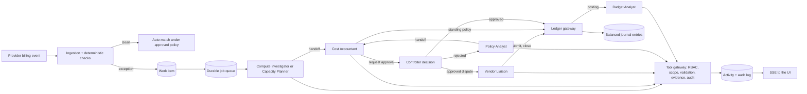

# ExperimentLedger

Autonomous finance operations for AI research labs. A team of six AI employees reconciles GPU invoices against what actually ran, disputes overcharges with cloud vendors, allocates shared cluster costs, watches research team budgets, and learns policy from the controller's corrections. They ask the controller when a decision needs a human. Every action is a typed tool call through an application gateway, written to an append-only audit log.

| Employee | Job |
| --- | --- |
| Compute Investigator | Figures out what actually ran behind an instance charge |
| Capacity Planner | Reconstructs who used a shared GPU reservation and how much sat idle |
| Cost Accountant | Charges costs to research teams under policy and drafts disputes |
| Vendor Liaison | Sends approved disputes to the provider and closes the case on their reply |
| Budget Analyst | Checks a team's burn against its budget after anything posts to it |
| Policy Analyst | Turns controller corrections into reusable policy |

**Seats it fills:** the GPU accounts-payable accountant who reconciles compute invoices against what actually ran, and the cost accountant who allocates shared cluster spend to research teams.

The fictional lab is **Atlas Research**. All source systems (scheduler, infrastructure controller, provider meters, invoices, ERP) are simulated in SQLite. The agent decisions, approvals, postings, and audit trail are real application state.

Work starts on its own: a scheduler syncs provider billing feeds on a cursor, follows up on approvals and vendor disputes as business days pass, and the Policy Analyst learned its first policy by mining six months of AP history. See [What runs on its own](#what-runs-on-its-own) and [Proof it works](#proof-it-works).

## Quick start

Requires Node.js 22 or newer.

```bash
npm install
npm run dev
# open http://localhost:3000
```

The first request creates `data/experiment-ledger.db`, loads the October 2026 sandbox, and starts the background worker. The sandbox seeds 35 invoice lines from `src/server/sim/cases.ts`: 13 clean lines auto-match, and 22 open work items for the agents (idle time, minimum-duration charges, billing past termination, rate mismatches, duplicate lines, missing experiment owners, and shared reservations). An existing database keeps its old seed until **Reset demo**.

Production build:

```bash
npm run build && npm start
```

## Environment variables

Copy `.env.example` to `.env.local`. All are optional.

| Variable | Default | Purpose |
| --- | --- | --- |
| `OPENAI_API_KEY` | unset | Enables LLM agents through the OpenAI Agents SDK. Without it the app runs in **Deterministic replay**. Server-side only. |
| `OPENAI_MODEL` | Agents SDK default | Model for LLM agents. |
| `AGENT_MODE` | `llm` if a key is set, else `deterministic` | Starting execution mode. Switch at runtime with `POST /api/settings {"mode": "llm"}`. |
| `DETERMINISTIC_STEP_DELAY_MS` | `700` | Pause between deterministic agent steps so the live timeline is watchable. |
| `DATABASE_PATH` | `./data/experiment-ledger.db` | SQLite file. |
| `OPENAI_AGENTS_DISABLE_TRACING` | unset | Set to `1` to stop the SDK exporting traces to OpenAI. |
| `SCHEDULER_INTERVAL_MS` | `5000` | How often the scheduler syncs billing feeds and runs follow-up rules. |
| `AUTONOMY` | on | Set to `off` to disable the scheduler (agents still run when work is queued). |
| `BILLING_FEED_URL` | unset | Optional external billing feed polled on a cursor: `GET <url>?after=<cursor>` returns `{ events, next_cursor }`. |

### Execution modes

- **LLM agents.** Each agent turn is an OpenAI Agents SDK run with typed Zod tools. The model chooses tools and writes findings; the run ends only when a terminal tool (handoff, approval request, posting request) succeeds.
- **Deterministic replay.** A fixed, scripted decision policy calls the same tools through the same gateway, with the same permissions and audit. It exists for demos without credentials and for tests. Runs in this mode are labeled "Deterministic replay" everywhere in the UI and are never presented as LLM output.

## Three-minute demo

1. **Work** has two views. **Board** is a Kanban (Investigate, Propose, Needs you, Vendor, Done) where the card an agent is on shows its live steps. **Canvas** puts the six employees on a ring around you. Each one spawns a small frame per piece of work; click an employee to zoom to its frames, and click a frame to zoom in and replay it (the query it ran, the rows it got back, the rules it checked, the letter it wrote).
2. Click **Simulate billing event**, keep **GPU overbilling**, and send it. Helios bills 36 h at $100/h for an instance whose lifecycle shows 24 h. Deterministic checks open a work item and assign the Compute Investigator.
3. Open the investigation. The **Flow** tab shows each agent's steps and what it gathered; **Log** has every tool call. Watch the Compute Investigator pull the lifecycle, scheduler log, provider meter, and contract, then hand off. The Cost Accountant cites the Helios precedent and proposes a $1,200 dispute. The chart shows the 12 h billed after termination.
4. **Approve** the dispute. The Vendor Liaison writes the letter and sends it; the ledger gateway submits it and posts only the supported $2,400. Accounts payable stays at $3,600 until you click **Vendor issues credit**, after which the Vendor Liaison reads the reply, books the credit, and closes the case. The Budget Analyst checks the team's burn after each posting.
5. Simulate **Shared cluster allocation** ($12,400, two teams). The Capacity Planner reconstructs usage and idle capacity. The Cost Accountant follows written policy v1 (usage split: $6,975 / $5,425) and tries to post it. The ledger gateway denies the posting because v1 conflicts with the reservation terms (a red denied event in the timeline and audit), so the agent requests approval instead.
6. **Reject** it with: "Reserved capacity must be charged to the team that owns the reservation, subject to company policy." The Policy Analyst proposes reusable policy **ALLOC-SHARED v2** from your correction, and the Cost Accountant reworks the allocation ($8,060 / $4,340). Approve both.
7. Simulate **Next month: similar reservation**. The agents apply the learned policy and the gateway posts it automatically, citing the policy approval. No new approval is needed.
8. Open **Audit trail**: every tool call, decision, posting, and denied action, hash-chained, plus policy versions, journal entries, and a trial balance.

**Custom invoice line** lets you type any hours and rate to create a discrepancy that is not scripted. **Resend last billing event** proves idempotency. **Reset demo** reloads the sandbox.

### Autonomy demo (no clicks needed for the work itself)

1. Open **Canvas**. On boot the Policy Analyst read six months of AP history and proposed **VARIANCE-MATERIALITY v1**: variances up to $50 were always paid as billed, every dispute was $96 or more. Approve it. It is the first item under **Needs you** in the sidebar: expand it and approve. (It also appears on the board.) The sidebar's **Running on its own** list shows each feed's sync position and every follow-up as it fires.
2. Wait two minutes, or use the clock in the top bar (**+1 hour**). The Helios and Meridian feeds publish new lines; the scheduler syncs them on a cursor and the agents work them: an exact match auto-posts, and a Helios A100 line billed $0.40/h over contract ($12) is accepted under the learned policy instead of disputed.
3. **+3 days**: a Helios line billed 6 h after termination arrives and becomes a $600 dispute waiting for you. Approve it, and the Vendor Liaison writes the dispute letter and sends it.
4. **+15 days**: Helios has not answered. The scheduler assigns the Vendor Liaison, which checks the dispute and sends a follow-up citing contract §7.2. **+16 days**: still nothing, so it escalates to the controller with a recommended next step. Leave an approval waiting and it is reminded after a day and escalated to the CFO after three.
5. In **Audit trail → Evaluation & autonomy**, **Run** the evaluation: 14 planted cases scored against the answer key. The same tab has the full feed and follow-up history.

## How it works



- **Work items** move through `NEW`, `INVESTIGATING`, `NEEDS_INFO`, `PROPOSED`, `NEEDS_APPROVAL`, `APPROVED`, `POSTED`, `DISPUTED`, `RESOLVED`. Invalid transitions are rejected and audited.
- **Collaboration** happens through the shared work item. The Compute Investigator records structured findings and hands off; the Cost Accountant reads them, proposes, and can send questions back.
- **Durability.** Jobs live in SQLite. Interrupted jobs are re-queued on restart, and approvals pause a workflow until a human decides.
- **Live updates.** Activity rows are streamed over server-sent events; a reconnect replays missed rows.

## What runs on its own

- **Scheduler.** Inside the worker, every `SCHEDULER_INTERVAL_MS`. It does not decide anything itself: it pulls work in and puts agent jobs on the same durable queue, so a crash or redeploy never loses work.
- **Feed sync.** Each provider feed is read from a cursor stored in `sync_cursors`, so a re-sync never re-reads a line; ingestion is also idempotent on event and line ids. A line that fails is recorded and set aside so the feed keeps flowing. The demo feeds publish over business time (`sim/feed-schedule.ts`); `BILLING_FEED_URL` points the same code at a real HTTP feed.
- **Business clock.** Finance runs over weeks. Reminders and chases measure age on a business clock that equals wall-clock time in production; the demo can move it forward, and every move is audited.
- **Follow-ups** (`workflow/follow-ups.ts`). Approval waiting 1 day: remind the controller. 3 days: escalate to the CFO (backup approver). Vendor dispute unanswered 14 days: the Vendor Liaison runs `get_dispute_status` and `send_vendor_follow_up`. 30 days: it runs `escalate_dispute` with a recommendation. Each action is keyed so it happens once, and every one is in the audit trail.
- **Onboarding** (`workflow/onboarding.ts`). Before the first close the Policy Analyst runs `query_ap_history` over the ERP's AP export and `propose_materiality_policy`. The application rejects a threshold that would have accepted any variance the vendor later credited. Once the controller approves, the ledger gateway lets variances at or below the threshold post without a dispute.

### Agents and tools

| Agent | Tools |
| --- | --- |
| Compute Investigator | `get_work_item`, `get_instance_lifecycle`, `get_gpu_job_logs`, `get_experiment`, `get_provider_usage`, `get_billing_terms`, `submit_compute_findings`, `handoff_to_finance`, `request_human_info` |
| Capacity Planner | `get_work_item`, `find_related_experiments`, `get_experiment`, `get_billing_terms`, `submit_compute_findings`, `handoff_to_finance`, `request_human_info` |
| Cost Accountant | `get_work_item`, `get_project_budget`, `get_allocation_policy`, `search_precedents`, `calculate_cost_allocation`, `propose_adjustment`, `propose_vendor_dispute`, `request_human_approval`, `submit_for_posting`, `request_more_info` (reads the learned materiality policy through `get_allocation_policy`) |
| Vendor Liaison | `get_work_item`, `get_dispute_package`, `get_billing_terms`, `send_vendor_dispute`, `close_dispute`, and for follow-ups `get_dispute_status`, `send_vendor_follow_up`, `escalate_dispute` |
| Budget Analyst | `get_work_item`, `get_posted_charges`, `get_project_budget`, `forecast_project_burn`, `record_budget_note` |
| Policy Analyst | `get_work_item`, `get_allocation_policy`, `search_precedents`, `propose_policy`, `handoff_to_finance`, and at onboarding `query_ap_history`, `propose_materiality_policy`, `finish_onboarding` |

All arithmetic is application code: billable hours, expected charges, allocations (largest-remainder rounding, always summing exactly), and dispute amounts. Agents choose actions and cite evidence; they cannot type amounts.

### Controls

- Role-based permissions per tool; agents can only act on their assigned work item.
- Agents cannot decide approvals or post. Only the ledger gateway posts, and only with an approved request or an approved standing policy.
- Segregation of duties: requesters and proposers cannot approve their own items; approvers must be human controllers.
- Guardrails reject findings that contradict the computed figures (for example, calling an overcharge "explained") and ownership claims not supported by retrieved records.
- Journal entries must balance, use known accounts, and are idempotent. Postings, journal lines, and audit events are append-only (SQLite triggers). Proposal content is immutable; approval decisions are final.
- Denied and failed actions are logged after the transaction rolls back, so they are never lost.
- Repeated billing events are ignored without new work or postings.
- A dispute never reduces accounts payable. Only a vendor credit does.

## Proof it works

**What is real:** every agent decision, tool call, approval, policy, journal entry, follow-up, and audit event is application state, enforced by the same gateway in both execution modes. **What is simulated:** the provider feeds, scheduler, infrastructure controller, meters, experiment tracker, ERP, AP history, and vendor portal.

There are two evaluations. The main one is the seeded-case harness (see [Evaluation](#evaluation)). A second, smaller check targets autonomy and judgment:

**Planted-error key.** `src/server/eval/answer-key.ts` plants 14 situations in invoice lines and states the correct outcome in hand-computed numbers: four real overcharges (billed after termination, rate above contract, wrong rate card, one extra hour), four correct invoices that look wrong (idle time after a job, an 8-hour contract minimum, per-started-hour metering, an exact match), and judgment calls (a $10 variance below materiality, an under-billing, a missing owner, a duplicate webhook, a shared reservation that fits policy, and one whose terms contradict policy). Each case runs in its own sandbox.

```bash
npm run eval:planted            # deterministic replay, writes docs/eval-report.md
npm run eval:planted -- --llm   # LLM agents, writes docs/eval-report-llm.md (needs OPENAI_API_KEY)
```

Deterministic replay scores 14/14 ([report](docs/eval-report.md)): 4/4 overcharges caught, no correct invoice disputed. That run checks the controls, arithmetic, and plumbing end to end; it is a scripted policy, so it is not evidence of model judgment. The LLM run is the meaningful score. **Audit trail → Evaluation & autonomy** can also run both.

## Tests

```bash
npm test
```

- **Autonomy:** feed sync on a cursor with no duplicates, onboarding proposes the $50 threshold the history supports, the learned policy changes the outcome of a $12 variance, approval reminders and escalations fire once, waiting time is measured from the request, and an unanswered dispute is chased at 14 days and escalated at 30.
- **Planted-error key:** deterministic replay matches all 14 hand-computed outcomes.
- **Arithmetic:** exact allocation sums and contract billable hours.
- **Correct billing:** an instance whose job ended early is explained with no dispute.
- **Scenario 1:** the Vendor Liaison sends the $1,200 dispute, and the liability stays unchanged until the Liaison books the vendor's credit.
- **Scenarios 2 and 3:** rejection, a policy proposed by the Policy Analyst, rework, policy approval, a restart from the same database file, then automatic reuse next month with exact amounts.
- **Denials:** agents approving or posting, and gateway posting without approval, are denied and audited.
- **Ledger integrity:** unbalanced entries are rejected, duplicate ingestion is ignored, and the audit log is append-only with its hash chain intact.
- **LLM wiring:** the real Agents SDK run loop is driven by the SDK's `ScriptedModel`, including recovery from a guardrail rejection.
- **Evaluation:** every seeded case is scored against its answer key, and a wrong key is shown to fail.

## Evaluation

```bash
npm run eval                 # deterministic agents
AGENT_MODE=llm npm run eval  # LLM agents (needs OPENAI_API_KEY)
```

Each seeded case in `src/server/sim/cases.ts` has an answer key: the expected outcome, dispute amount, expense per project, and the policy that should authorize the posting. The harness (`src/server/eval/harness.ts`) seeds an in-memory database, lets the agents work every case, and plays the controller from the key: it approves matching proposals, rejects others with the key's correction, answers ownership questions, and sends the vendor reply. It reports:

- **Accuracy:** cases whose final state matches the key.
- **False-positive dispute rate:** disputes proposed on charges the records support.
- **Correct policy use:** postings authorized by the expected policy, or by a controller approval when no policy should apply.
- **Recovery:** cases that end correct after the controller rejected work.

Deterministic replay currently scores 35/35, 0/25 false-positive disputes, 33/33 policy use, and 3/3 recovered. Case O-02 depends on something only the controller knows, so a first dispute is expected; it counts toward recovery and is left out of the false-positive rate.

## Project layout

```
src/server/agents      tools, gateway, LLM runner (Agents SDK), deterministic policies, prompts
src/server/workflow    ingestion, checks, approvals, decisions, ledger gateway, policies, jobs
src/server/domain      money, billing, allocation, state machine
src/server/security    actors, permissions, guard
src/server/sim         seed data, demo scenarios, feed schedule, AP history (simulated source systems)
src/server/sync        billing feed sync with cursors (simulated outbox and HTTP adapter)
src/server/eval        answer key and evaluation runner
src/server/scheduler.ts, clock.ts   what starts work on its own, and the business clock
src/app                pages and API routes (SSE at /api/stream)
src/components         dashboard, investigation workspace, autonomy page, audit trail
scripts/eval.ts        npm run eval (seeded-case harness)
scripts/eval-planted.ts  npm run eval:planted (planted-error key)
drizzle/               SQL migrations
tests/                 Vitest suite
```

## Limitations

- **LLM mode:** no OpenAI key was available while building, so LLM mode was verified through the SDK's scripted model, not live model calls. Deterministic replay is the default when no key is set.
- **One demo user:** there is no login. Every human action is taken as the controller, Priya Natarajan.
- **Simulated systems:** source systems, the ERP, AP history, the billing feeds, and the vendor portal are simulated, and vendor responses are triggered from the UI. Reminders and vendor messages are recorded, not actually emailed.
- **Investigation page:** the Flow tab on an investigation still shows only the Compute Investigator and the Cost Accountant. The Canvas shows all six.
- **Existing databases:** actors are append-only, so a database created before the rename keeps the old names "Compute Agent" and "Finance Agent" until **Reset demo**. New employees are added automatically at startup.
- **Runs while the server runs:** SQLite runs on one node, and the worker and scheduler run inside the Next.js server process, so nothing happens while it is stopped (queued jobs and due follow-ups resume on restart); restart the dev server after changing server code.
- **Reset wipes everything:** Reset demo deletes the sandbox, including its audit log. It is a demo control, not a production feature.
