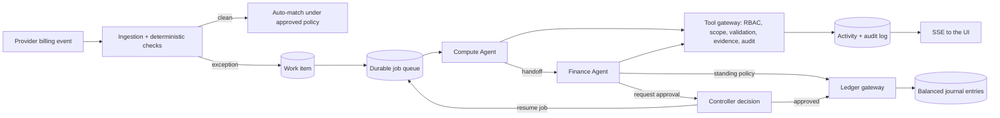

# ExperimentLedger

Autonomous finance operations for AI research labs. A Compute Agent and a Finance Agent reconcile GPU invoices against what actually ran, dispute overcharges, allocate shared cluster costs, and ask the controller when a decision needs a human. Every action is a typed tool call through an application gateway, written to an append-only audit log.

The fictional lab is **Atlas Research**. All source systems (scheduler, infrastructure controller, provider meters, invoices, ERP) are simulated in SQLite. The agent decisions, approvals, postings, and audit trail are real application state.

## Quick start

Requires Node.js 22 or newer.

```bash
npm install
npm run dev
# open http://localhost:3000
```

The first request creates `data/experiment-ledger.db`, loads the October 2026 sandbox, and starts the background worker. One seeded invoice is left for the agents, so the team is working when you open the dashboard.

Production build:

```bash
npm run build && npm start
```

## Environment variables

Copy `.env.example` to `.env.local`. All are optional.

| Variable | Default | Purpose |
| --- | --- | --- |
| `OPENAI_API_KEY` | unset | Enables LLM agents through the OpenAI Agents SDK. Without it the app runs in **Deterministic replay**. Server-side only. |
| `OPENAI_MODEL` | Agents SDK default | Model for LLM agents. |
| `AGENT_MODE` | `llm` if a key is set, else `deterministic` | Starting execution mode. You can also switch modes in the sidebar. |
| `DETERMINISTIC_STEP_DELAY_MS` | `700` | Pause between deterministic agent steps so the live timeline is watchable. |
| `DATABASE_PATH` | `./data/experiment-ledger.db` | SQLite file. |
| `OPENAI_AGENTS_DISABLE_TRACING` | unset | Set to `1` to stop the SDK exporting traces to OpenAI. |

### Execution modes

- **LLM agents.** Each agent turn is an OpenAI Agents SDK run with typed Zod tools. The model chooses tools and writes findings; the run ends only when a terminal tool (handoff, approval request, posting request) succeeds.
- **Deterministic replay.** A fixed, scripted decision policy calls the same tools through the same gateway, with the same permissions and audit. It exists for demos without credentials and for tests. Runs in this mode are labeled "Deterministic replay" everywhere in the UI and are never presented as LLM output.

## Three-minute demo

1. **Work** has two views. **Board** is a Kanban (Investigate, Propose, Needs you, Vendor, Done) where the card an agent is on shows its live steps. **Canvas** maps the whole system (invoices, Compute Agent, Finance Agent, you, ledger, vendor) with live counts and moving connections.
2. Click **Simulate billing event**, keep **GPU overbilling**, and send it. Helios bills 36 h at $100/h for an instance whose lifecycle shows 24 h. Deterministic checks open a work item and assign the Compute Agent.
3. Open the investigation. The **Flow** tab shows each agent's steps and what it gathered; **Log** has every tool call. Watch the Compute Agent pull the lifecycle, scheduler log, provider meter, and contract, then hand off. The Finance Agent cites the Helios precedent and proposes a $1,200 dispute. The chart shows the 12 h billed after termination.
4. **Approve** the dispute. The ledger gateway submits it and posts only the supported $2,400. Accounts payable stays at $3,600 until you click **Vendor issues credit**.
5. Simulate **Shared cluster allocation** ($12,400, two teams). The Finance Agent follows written policy v1 (usage split: $6,975 / $5,425) and tries to post it. The ledger gateway denies the posting because v1 conflicts with the reservation terms (a red denied event in the timeline and audit), so the agent requests approval instead.
6. **Reject** it with: "Reserved capacity must be charged to the team that owns the reservation, subject to company policy." The Finance Agent reworks the allocation ($8,060 / $4,340) and proposes reusable policy **ALLOC-SHARED v2**. Approve both.
7. Simulate **Next month: similar reservation**. The agents apply the learned policy and the gateway posts it automatically, citing the policy approval. No new approval is needed.
8. Open **Audit trail**: every tool call, decision, posting, and denied action, hash-chained, plus policy versions, journal entries, and a trial balance.

**Custom invoice line** lets you type any hours and rate to create a discrepancy that is not scripted. **Resend last billing event** proves idempotency. **Reset demo** reloads the sandbox.

## How it works



- **Work items** move through `NEW`, `INVESTIGATING`, `NEEDS_INFO`, `PROPOSED`, `NEEDS_APPROVAL`, `APPROVED`, `POSTED`, `DISPUTED`, `RESOLVED`. Invalid transitions are rejected and audited.
- **Collaboration** happens through the shared work item. The Compute Agent records structured findings and hands off; the Finance Agent reads them, proposes, and can send questions back.
- **Durability.** Jobs live in SQLite. Interrupted jobs are re-queued on restart, and approvals pause a workflow until a human decides.
- **Live updates.** Activity rows are streamed over server-sent events; a reconnect replays missed rows.

### Agents and tools

| Agent | Tools |
| --- | --- |
| Compute Agent | `get_work_item`, `get_instance_lifecycle`, `get_gpu_job_logs`, `get_experiment`, `get_provider_usage`, `get_billing_terms`, `find_related_experiments`, `submit_compute_findings`, `handoff_to_finance`, `request_human_info` |
| Finance Agent | `get_work_item`, `get_project_budget`, `get_allocation_policy`, `search_precedents`, `calculate_cost_allocation`, `propose_adjustment`, `propose_vendor_dispute`, `propose_policy`, `request_human_approval`, `submit_for_posting`, `request_more_info` |

All arithmetic is application code: billable hours, expected charges, allocations (largest-remainder rounding, always summing exactly), and dispute amounts. Agents choose actions and cite evidence; they cannot type amounts.

### Controls

- Role-based permissions per tool; agents can only act on their assigned work item.
- Agents cannot decide approvals or post. Only the ledger gateway posts, and only with an approved request or an approved standing policy.
- Segregation of duties: requesters and proposers cannot approve their own items; approvers must be human controllers.
- Guardrails reject findings that contradict the computed figures (for example, calling an overcharge "explained") and ownership claims not supported by retrieved records.
- Journal entries must balance, use known accounts, and are idempotent. Postings, journal lines, and audit events are append-only (SQLite triggers). Proposal content is immutable; approval decisions are final.
- Denied and failed actions are logged after the transaction rolls back, so they are never lost.
- Repeated billing events are ignored without new work or postings.
- A dispute never reduces accounts payable. Only a vendor credit does.

## Tests

```bash
npm test
```

- **Arithmetic:** exact allocation sums and contract billable hours.
- **Correct billing:** an instance whose job ended early is explained with no dispute.
- **Scenario 1:** the $1,200 dispute leaves the liability unchanged until the vendor credits it.
- **Scenarios 2 and 3:** rejection, rework, policy approval, a restart from the same database file, then automatic reuse next month with exact amounts.
- **Denials:** agents approving or posting, and gateway posting without approval, are denied and audited.
- **Ledger integrity:** unbalanced entries are rejected, duplicate ingestion is ignored, and the audit log is append-only with its hash chain intact.
- **LLM wiring:** the real Agents SDK run loop is driven by the SDK's `ScriptedModel`, including recovery from a guardrail rejection.

## Project layout

```
src/server/agents      tools, gateway, LLM runner (Agents SDK), deterministic policies, prompts
src/server/workflow    ingestion, checks, approvals, decisions, ledger gateway, policies, jobs
src/server/domain      money, billing, allocation, state machine
src/server/security    actors, permissions, guard
src/server/sim         seed data and demo scenarios (simulated source systems)
src/app                pages and API routes (SSE at /api/stream)
src/components         dashboard, investigation workspace, audit trail
drizzle/               SQL migrations
tests/                 Vitest suite
```

## Limitations

- **LLM mode:** no OpenAI key was available while building, so LLM mode was verified through the SDK's scripted model, not live model calls. Deterministic replay is the default when no key is set.
- **One demo user:** there is no login. Every human action is taken as the controller, Priya Natarajan.
- **Simulated systems:** source systems, the ERP, and the vendor portal are simulated, and vendor responses are triggered from the UI.
- **Two agents:** contract review is part of the Compute Agent; there is no separate Contract Agent.
- **Single-node storage:** SQLite runs on one node. The worker runs inside the Next.js server process; restart the dev server after changing server code.
- **Reset wipes everything:** Reset demo deletes the sandbox, including its audit log. It is a demo control, not a production feature.
